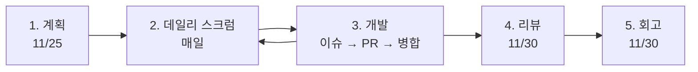

# 작업 프로세스

> 이번 스프린트에서 **언제, 무엇을, 어디에 기록하는지** 정리한 페이지예요.

## 스프린트 한눈에 보기

- 기간: **2026-11-25(수) ~ 2026-11-30(월)**, 이번 한 번뿐인 스프린트예요.
- 흐름: 계획 → 데일리 스크럼 → 개발 → 리뷰 → 회고



| 날짜                  | 하는 일                         |
| --------------------- | ------------------------------- |
| 11/25(수)             | 계획, 개발 시작                 |
| 11/26(목) ~ 11/29(일) | 데일리 스크럼 + 개발            |
| 11/30(월)             | 데일리 스크럼, 리뷰, 회고, 제출 |

## 단계별로 할 일

| 단계             | 언제     | 무엇을                                                  | 어디에 기록                                    |
| ---------------- | -------- | ------------------------------------------------------- | ---------------------------------------------- |
| 1. 계획          | 11/25    | 만들 기능을 이슈로 쪼개고 담당자와 Priority를 정해요    | 이슈 + Project 보드, 결정 내용은 Wiki 회의록   |
| 2. 데일리 스크럼 | 매일 1회 | 어제 한 일, 오늘 할 일, **막힌 점 한 줄**               | Wiki 데일리 스크럼 페이지                      |
| 3. 개발          | 매일     | 이슈 → 브랜치 → PR → 리뷰 → 병합                        | 이슈, PR (코드와 함께 바뀌는 문서는 PR에 포함) |
| 4. 리뷰          | 11/30    | 결과물이 동작하는지 함께 확인하고, 제출 파일을 점검해요 | Wiki 회의록                                    |
| 5. 회고          | 11/30    | KPT로 전체 회고                                         | Wiki `회고-2026-11-30` 페이지                  |

### 1. 계획

- 기능 하나 = 이슈 하나. 하루 안에 끝낼 수 있는 크기로 쪼개요.
- 이슈를 보드에 올리고 담당자(Assignees)와 Priority를 정해요. → [라벨 및 보드 가이드](라벨-및-보드-가이드.md)
- 기술 선택(예: DB, 프레임워크)을 정했다면 ADR로 남겨요. → [문서 작성 기준](문서-작성-기준.md)

### 2. 데일리 스크럼

각자 아래 세 줄만 말하고 적어요.

```text
- 어제 한 일:
- 오늘 할 일:
- 막힌 점 한 줄: (없으면 "없음")
```

- "막힌 점 한 줄"이 **하루 회고**예요. → [회고](회고.md)
- 막힌 점은 스크럼이 끝난 뒤 관련된 사람끼리 따로 풀어요.

### 3. 개발

- 이슈 생성부터 병합까지는 [협업 규칙](협업-규칙.md)을 그대로 따라요.
- AI에게 작업을 맡겼다면 위임 로그를 써요. → [문서 작성 기준](문서-작성-기준.md)

### 4. 리뷰 (11/30)

- 실제로 실행해 보며 기능이 동작하는지 확인해요.
- 제출 필수 파일이 정확한 경로에 있는지 점검해요. → [문서 작성 기준의 제출 필수 파일](문서-작성-기준.md)

### 5. 회고 (11/30)

- KPT 방식으로 진행해요. → [회고](회고.md)

---

규칙 변경은 데일리 스크럼에서 논의 후 PO가 반영합니다.
