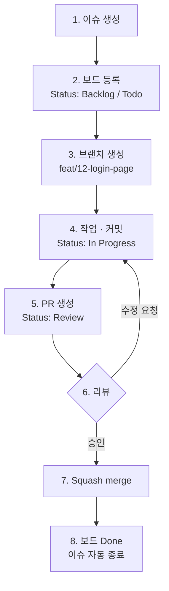

# 협업 규칙

> 이 페이지만 따라 하면 **이슈 생성부터 PR 병합까지** 혼자 진행할 수 있어요.
> nbnmbnb
> 📌 협업 규칙의 **원본은 레포의 [`git.md`](https://github.com/GYNHSB/no-such-company/blob/main/git.md)** 예요. Wiki는 자세한 안내를 담아요.
> 규칙을 바꿀 때는 **`git.md`를 먼저 PR로 고치고**, Wiki에는 바뀐 내용 안내와 링크만 반영해요.

## 왜 이 규칙을 쓰나요?

1. **커밋 기록 정리**: Squash merge로 PR 1개가 main 커밋 1개가 되어 기록이 깔끔해요.
2. **작업 추적**: 이슈, 브랜치, PR, 보드가 이슈 번호로 연결되어 누가 무엇을 하는지 한눈에 보여요.
3. **리뷰 품질**: 모든 변경이 리뷰와 승인을 거쳐야 main에 들어가요.

## 한눈에 보는 핵심 규칙

| 항목        | 규칙                                                                    |
| ----------- | ----------------------------------------------------------------------- |
| 브랜치 전략 | GitHub Flow (`main` + 작업 브랜치)                                      |
| 브랜치 이름 | `타입/이슈번호-작업내용` (예: `feat/12-login-page`)                     |
| PR 제목     | `타입: 작업 요약 (#이슈번호)` (예: `feat: 로그인 페이지 UI 구현 (#12)`) |
| PR 본문     | `Closes #이슈번호` 필수                                                 |
| 이슈와 PR   | 이슈 1개 = PR 1개                                                       |
| 리뷰        | PR이 올라오고 24시간 안에                                               |
| 병합 조건   | 승인 1명 이상 + 리뷰 코멘트 모두 해결                                   |
| 병합 방식   | Squash merge만, PR 작성자가 직접                                        |
| main 브랜치 | 보호되어 있어 직접 push 불가                                            |

## 전체 작업 흐름

| 단계            | 할 일                                              | 자세히 보기                                   |
| --------------- | -------------------------------------------------- | --------------------------------------------- |
| 1. 이슈 생성    | Issues 탭에서 New issue, 타입 라벨 붙이기          | [라벨 및 보드 가이드](라벨-및-보드-가이드.md) |
| 2. 보드 등록    | 이슈를 Project 보드에 추가, Status와 Priority 설정 | [라벨 및 보드 가이드](라벨-및-보드-가이드.md) |
| 3. 브랜치 생성  | main을 최신화한 뒤 규칙에 맞는 이름으로 생성       | [브랜치 및 PR 규칙](브랜치-및-PR-규칙.md)     |
| 4. 작업 · 커밋  | 작업하고 커밋, 보드를 In Progress로                | [Git 명령어 가이드](Git-명령어-가이드.md)     |
| 5. PR 생성      | 제목·본문·라벨·리뷰어 설정, 보드를 Review로        | [브랜치 및 PR 규칙](브랜치-및-PR-규칙.md)     |
| 6. 리뷰         | 리뷰어는 24시간 안에 리뷰, 작성자는 코멘트 반영    | [리뷰 및 병합 규칙](리뷰-및-병합-규칙.md)     |
| 7. Squash merge | 승인 후 PR 작성자가 직접 병합                      | [리뷰 및 병합 규칙](리뷰-및-병합-규칙.md)     |
| 8. 보드 Done    | 이슈가 자동으로 닫히고 Done으로 이동               | [라벨 및 보드 가이드](라벨-및-보드-가이드.md) |

## 세부 페이지

- [브랜치 및 PR 규칙](브랜치-및-PR-규칙.md): 브랜치 이름, PR 제목과 타입, PR 템플릿, 좋은 예와 나쁜 예
- [라벨 및 보드 가이드](라벨-및-보드-가이드.md): 라벨을 붙이는 시점, 보드 Status와 Priority 기준
- [리뷰 및 병합 규칙](리뷰-및-병합-규칙.md): 리뷰어 지정, 리뷰 기한, 승인과 병합 절차, 코멘트 작성 팁
- [Git 명령어 가이드](Git-명령어-가이드.md): 복사해서 쓰는 명령어, 충돌 해결, 자주 하는 실수

## 참고

- Project 보드: (보드 링크 추가 예정)
- 레포 설정(브랜치 보호, 라벨, 병합 방식 등) 변경은 **PO와 상의한 뒤** 진행해요.

---

규칙 변경은 데일리 스크럼에서 논의 후 PO가 반영합니다.
